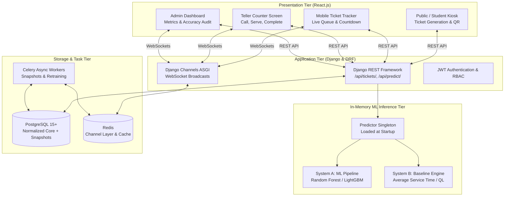

# Project Master Plan: ML-Driven Queue Waiting-Time Prediction & Management System

> **Version:** 1.0  
> **Status:** Active / Kickoff  
> **Target Environment:** Python 3.12, Django REST Framework, PostgreSQL 15+, React.js (Vite), Scikit-Learn / XGBoost  
> **Repository:** `ML-Time-predict-system`

---

## 1. Executive Summary & Vision

Long waiting lines in service facilities (e.g., college account sections, healthcare clinics, banking halls, and administrative offices) cause customer frustration, operational bottlenecks, and unpredictable staff workloads. Traditional queue estimation methods either rely on static historical averages or simplistic rule-of-thumb counters that fail during demand surges and non-linear delays.

This project delivers an end-to-end **ML-Driven Queue Waiting-Time Prediction and Management System** that:
1. Replaces guesswork with **machine learning regression models** (Random Forest, Gradient Boosting) trained on historical queue dynamics.
2. Implements a **dual-engine prediction architecture**: primary ML inference backed by analytical queueing theory ($M/M/1$, $M/M/c$, AST) fallback logic to guarantee high availability.
3. Serves predictions in **under 10 milliseconds** via an in-memory singleton predictor embedded directly in a Django REST Framework API.
4. Synchronizes real-time queue states across **React.js** client interfaces (self-service kiosk, student mobile tracker, teller counter desk, and administrative operations dashboard) using WebSockets.

---

## 2. Core Operational Constraints & Performance Targets

| Operational Metric | Target / SLA | Rationale |
|---|---|---|
| **Inference Latency** | **$\le 10\text{ ms}$** per ticket request | Physical kiosks and digital ticket issuance cannot introduce perceived delay at check-in. |
| **Prediction Accuracy Threshold** | **MAE lower than Baseline AST by $\ge 15\%$** | The ML model must justify its deployment complexity over simple Average Service Time formulas. |
| **Prediction Target Variable** | **Queue Waiting Time ($W_q$)** in minutes | Time elapsed between ticket issuance ($t_A$) and counter service commencement ($t_S$). |
| **High-Availability Fallback** | **100% Uptime via AST / QL Fallback** | If the ML model encounters missing inputs or unexpected exceptions, the system seamlessly falls back to analytical queue formulas without failing the API request. |
| **Data Leakage Prohibition** | **Strict $t_A$ Temporal Isolation** | No post-arrival information (e.g., actual service duration $S$, completion time $t_D$, future queue arrivals) may enter the feature matrix. |

---

## 3. Technology Architecture & Stack Rationale



### Why Python (Django REST Framework) Over Node.js
- **Sub-10 ms In-Memory Inference:** Trained Scikit-Learn / XGBoost models load directly into Django process memory via `joblib`. Node.js would require a separate Python microservice, adding cross-network HTTP overhead, JSON serialization delay, and dual-backend infrastructure complexity.
- **Built-in Admin Panel:** Instant management console for viewing counters, ticket history, and model prediction logs without writing custom administrative frontend code.
- **Robust ORM & Migrations:** Mature relational modeling and transaction safety in PostgreSQL.

---

## 4. Dataset Assets & Baseline Profiling

The repository contains pre-gathered queue datasets in the `data/` directory:

1. **`data/verified_queue_waiting_time_dataset.csv`** (Primary Dataset):
   - **Rows:** 12,017 verified transaction records.
   - **Date Range:** October 5, 2026 to October 22, 2026.
   - **Columns:**
     - `arrival_time`: Timestamp when student entered queue ($t_A$).
     - `start_time`: Timestamp when student reached counter ($t_S$).
     - `finish_time`: Timestamp when service completed ($t_D$).
     - `wait_time`: Realized queue delay ($W_q$) in minutes (Mean: $102.40\text{ min}$, Std: $66.81\text{ min}$, Range: $0.00\text{ to } 275.82\text{ min}$).
     - `queue_length`: Headcount waiting ahead upon arrival ($L_q$) (Mean: $132.4$, Max: $340$).
   - **Service Duration Profiling:** $\mathbb{E}[S] = 2.38\text{ minutes}$ ($\sigma = 2.41\text{ min}$).
2. **`data/queue_data.csv`:** 560 transactional records for exploratory verification.
3. **`data/wait_times.csv`:** Supplementary multi-day logs.
4. **`data/DataDictionary.xlsx`:** Feature definitions and domain rules.

---

## 5. Eight-Phase Implementation Plan

```
[Phase 1: Framing & Target Definition] ──► [Phase 2: Data Ingestion & Audit]
                                                    │
                                                    ▼
                                           [Phase 3: Preprocessing & Feature Engineering]
                                                    │
                                ┌───────────────────┴───────────────────┐
                                ▼                                       ▼
                     [Phase 4: Baselines]                    [Phase 6: PostgreSQL DB]
                                │                                       │
                                ▼                                       │
                     [Phase 5: ML Models]                               │
                                │                                       │
                                └───────────────────┬───────────────────┘
                                                    ▼
                                         [Phase 7: DRF API Serving]
                                                    │
                                                    ▼
                                         [Phase 8: React UI & MLOps]
```

### Phase 1: Problem Formulation, Target Definition & SLAs
- **Goal:** Formalize target variable formulas, baseline comparison metrics, and latency constraints.
- **Target Formulation:** Pure Queue Waiting Time $W_q = t_S - t_A$ (in minutes).
- **Deliverables:** Verified SLA requirements document and metric definitions.

### Phase 2: Data Ingestion, Hygiene & Schema Audit
- **Goal:** Load raw records, parse ISO timestamps, detect nulls or corrupted entries, and filter anomalies.
- **Rules:** Drop negative wait times ($t_S < t_A$); apply Interquartile Range (IQR) bounds to remove artificial logging freezes.
- **Deliverables:** Cleaned staging dataset ready for feature pipeline.

### Phase 3: Data Preprocessing & Feature Engineering
- **Goal:** Extract prediction-time features strictly using information available at $t_A$:
  - `queue_length`: Instantaneous queue depth.
  - `arrival_hour`: Hour of arrival ($0 \dots 23$), with cyclical sine/cosine transforms.
  - `day_of_week`: Day of week ($0 \dots 6$).
  - `is_weekend`: Binary flag.
  - `rolling_service_rate`: Recent rolling average throughput.
  - `last_served_wait`: Delay of the most recent customer called before $t_A$ (LES).
- **Target Transformation:** Log transform $y = \ln(W_q + 1)$ to stabilize right-skewed queue distributions.
- **Deliverables:** Leakage-free feature matrix split chronologically into train (80%) and test (20%).

### Phase 4: Baseline Benchmarking & Heuristic Development
- **Goal:** Establish non-ML benchmark performance floors:
  1. **Historical Mean:** Mean $W_q$ across train split.
  2. **Last-To-Enter-Service (LES):** Delay of the last completed transaction.
  3. **Average Service Time (AST) Formula:** $\widehat{W}_{\text{AST}} = \frac{L_q \times \overline{S}}{c}$.
  4. **Analytical Queue-Length Estimator:** $\widehat{W}_{\text{QL}} = \frac{L_q + 1}{c \cdot \mu}$.
- **Deliverables:** Baseline error matrix (MAE, RMSE, MAPE) serving as the gating hurdle for ML models.

### Phase 5: Machine Learning Model Development & Validation
- **Goal:** Train and tune candidate regression algorithms:
  - Linear / Ridge Regression (interpretability baseline)
  - Random Forest Regressor (`n_estimators=150`, `max_depth=12`)
  - HistGradientBoostingRegressor / LightGBM / XGBoost
- **Validation:** Chronological rolling-window time series cross-validation.
- **Evaluation Criteria:** Model MAE must be $\ge 15\%$ lower than AST baseline.
- **Serialization:** Export winning pipeline via `joblib.dump(pipeline, "artifacts/wait_time_model.joblib")`.

### Phase 6: Database Architecture & PostgreSQL Setup
- **Goal:** Deploy normalized relational schema in PostgreSQL 15+:
  - `branches`, `departments`, `services`, `counters`, `staff_users`
  - `tickets`, `service_transactions`
  - `queue_status_snapshots` (per-minute or hourly system snapshots)
  - `rolling_service_metrics` (delay-history and AST cache)
  - `prediction_logs` & `model_registry` (audit trail)
- **Indexing:** Specialized partial B-tree indexes on `(service_id, transaction_status)` where `transaction_status = 'waiting'` for instantaneous queue count queries.

### Phase 7: Backend Serving, DRF API & Dual-Engine Fallback
- **Goal:** Scaffold Django REST API with low-latency in-memory model loading.
- **Endpoints:**
  - `POST /api/tickets/`: Issue ticket, compute instantaneous features, run in-memory inference ($\le 10$ ms), log prediction, and return estimated wait time.
  - `PATCH /api/tickets/{id}/status/`: Transition ticket (`waiting` $\to$ `in_service` $\to$ `completed`).
  - `GET /api/counters/{id}/queue/`: Retrieve active waiting queue for teller desk.
  - `GET /api/analytics/dashboard/`: Metrics and prediction accuracy audit (Predicted vs. Realized).
- **Dual-Engine Logic:** Automatic try/except fallback to AST baseline if ML predictor is unavailable.

### Phase 8: React.js Frontend, Real-Time WebSockets & MLOps
- **Goal:** Build intuitive responsive interfaces using React.js (Vite):
  - **Student Kiosk & Mobile Web:** Draw token, check-in, real-time wait countdown.
  - **Counter Staff UI:** "Call Next", "Start Service", "Complete", "Mark Absent".
  - **Waiting Area TV Display:** Current token called, active counter number, estimated wait.
  - **Operations Dashboard:** Live queue depth, server utilization ($\rho$), arrival rate ($\lambda$), and live prediction error.
- **Real-Time Layer:** Django Channels (ASGI) + Redis broadcasting `queue:updated` and `ticket:called`.

---

## 6. Milestones & Delivery Schedule

```
Week  1 - 2:  Phase 1 & Phase 2 (Target definition, data audit, cleaning)
Week  3 - 4:  Phase 3 (Feature engineering, train/test chronological split)
Week  5 - 6:  Phase 4 & Phase 6 (Baselines calculation, PostgreSQL schema setup)
Week  7 - 8:  Phase 5 (ML model training, tuning, SHAP explainability, .joblib export)
Week  9 - 10: Phase 7 (Django REST Framework API, in-memory singleton, fallback engine)
Week 11 - 12: Phase 8 (React frontend, WebSockets, admin dashboard, end-to-end integration)
```

---

## 7. Risk Management & Mitigations

| Identified Risk | Impact | Mitigation Strategy |
|---|---|---|
| **Data Leakage in Feature Engineering** | High (false model confidence) | Strict timestamp audit; feature extraction pipeline only accepts features known at or before $t_A$. |
| **ML Model Fails to Beat Baseline AST** | High (wasted ML engineering) | Phase 4 establishes an immediate baseline hurdle; models must demonstrate statistical improvement before backend integration. |
| **Inference Latency Exceeds 10 ms** | Medium (kiosk delay) | Preload model into process memory at Django startup (`AppConfig.ready()`); use cached rolling metrics rather than live multi-table aggregation queries. |
| **Model Drift Over Time** | Medium (gradual error inflation) | `prediction_logs` table logs every prediction alongside actual realized wait times, triggering alerts when weekly MAE rises by $> 10\%$. |
