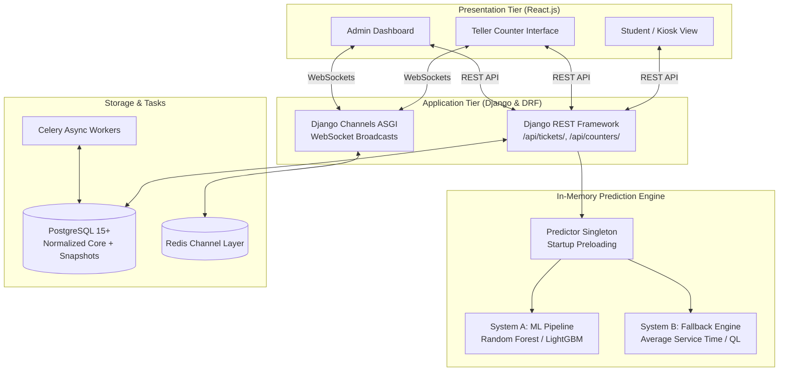

# ML-Time-predict-system

> **An End-to-End Machine-Learning Queue Waiting-Time Prediction & Real-Time Management System**  
> Built with operational queueing theory ($M/M/1$, $M/M/c$), Python (Scikit-Learn, Django REST Framework), PostgreSQL, and React.js.

---

## 📌 Project Overview

In service facilities such as university account sections, healthcare clinics, and banking halls, prolonged waiting lines and unpredictable delays lead to customer frustration and staff overload.

This repository implements a **dual-engine waiting-time prediction platform**:

- **System A (Primary ML Engine):** In-memory Scikit-Learn / Gradient Boosting regression pipeline delivering accurate, non-linear waiting-time estimates in **$\le 10$ milliseconds**.
- **System B (Deterministic Fallback):** Analytical Queue-Length ($\widehat{W}_{\text{QL}}$) and rolling Average Service Time (AST) formula ensuring zero-downtime availability.
- **Real-Time Client Tier:** Full-stack interface for self-service kiosks, student mobile tracking, teller counter operations, and administrative dashboards synchronized via WebSockets.

---

## 🏗️ System Architecture



---

## 🗂️ Repository Directory Structure

```
ML queue/
├── PLAN.md                                    # Master Implementation Plan (Phases 1-8, SLA, Architecture)
├── TASKS.md                                   # Actionable Task Checklist with priorities and checkboxes
├── WORK_BREAKDOWN_SCHEDULE.md                 # Formal WBS (1.0 - 8.0), Gantt schedule, and effort allocation
├── README.md                                  # Workspace overview and quickstart guide
├── main.py                                    # Python data ingestion, training & evaluation pipeline
├── wait_time_rf_model.joblib                  # Serialized Random Forest model artifact (33.3 MB)
│
├── queue_backend/                             # Django REST Framework Backend Application
│   ├── manage.py                              # Django management script
│   ├── queue_backend/                         # Project settings & URL routing
│   │   ├── settings.py                        # CORS, DRF, and installed apps configuration
│   │   └── urls.py                            # Root routing (/, /api/, /admin/)
│   └── api/                                   # REST API & ML Serving Application
│       ├── apps.py                            # Server boot preloader (WaitTimePredictor singleton)
│       ├── ml_service.py                      # Thread-safe dual-engine inference service
│       ├── views.py                           # ApiRootView, PredictWaitTimeView (GET & POST)
│       ├── urls.py                            # /api/predict/ route registration
│       ├── models.py                          # Relational database models (Phase 6)
│       └── wait_time_rf_model.joblib          # Resident model artifact for low-latency inference
│
├── data/                                      # Queue datasets and data dictionary
│   ├── verified_queue_waiting_time_dataset.csv # Primary verified dataset (12,017 records, Oct 2026)
│   ├── queue_data.csv                         # Historical queue samples (560 rows)
│   ├── wait_times.csv                         # Multi-day logs (1,968 rows)
│   └── DataDictionary.xlsx                    # Field definitions and metadata
│
└── research/                                  # Comprehensive research documentation
    ├── README.md                              # Research index and cross-references
    ├── 00_queuing_theory_fundamentals_and_numerical_walkthrough.md # Little's Law & M/M/1 vs M/M/c analysis
    ├── 01_features_and_target_variables.md    # Feature taxonomy, leakage prevention, target formulations
    ├── 02_baseline_models_and_queueing_theory.md # Non-ML benchmarks (LES, HOL, AST, QL formulas)
    ├── 03_data_collection_protocol_college_queue.md # Observational protocol for unlogged queues
    ├── 04_database_design_and_entities.md     # Relational schema, snapshots, feature cache, ER diagram
    ├── 05_system_architecture_react_django_postgres.md # Full-stack topology and Celery workers
    ├── 06_django_ml_integration_guide.md      # Low-latency singleton serving in DRF (<= 10 ms)
    ├── 07_component_specifications.md         # Requirements for Frontend, Backend, Database, ML
    ├── 08_implementation_roadmap_and_schedule.md # 12-week Gantt schedule and CRISP-DM phases
    └── 09_project_kickoff_and_technology_selection.md # Why start with Data first, Django vs Node.js
```

---

## 📖 Quick Links & Documentation

### 📑 Documentation & Codebase Audit (`docs/`)
- 📑 **Documentation Center Index:** [`docs/README.md`](docs/README.md) — Documentation navigation & audit portal.
- 📋 **Codebase & Dataset Audit:** [`docs/AUDIT.md`](docs/AUDIT.md) — Full audit of all 12,017 records, statistical distributions, code state, and SLAs.
- 🔄 **Change History & Changelog:** [`docs/CHANGELOG.md`](docs/CHANGELOG.md) — Chronological log of all commits, refactors, and feature additions.
- ✅ **Task Execution Matrix:** [`docs/TASKS.md`](docs/TASKS.md) — Sprint 1 priorities, phase-by-phase status, and deliverables.
- 📐 **Architecture & Implementation Plan:** [`docs/PLAN.md`](docs/PLAN.md) — Dual-engine prediction topology, data pipeline, and delivery roadmap.

### 📋 Project Planning & Management
- 📋 **Master Implementation Plan:** [`PLAN.md`](PLAN.md) — Vision, SLAs, 8-phase methodology, dual-engine fallback, and risk mitigations.
- ✅ **Actionable Task Checklist:** [`TASKS.md`](TASKS.md) — Prioritized checklist (`P0`, `P1`, `P2`) with status tracking and sprint focus.
- 📊 **Work Breakdown Structure & Schedule:** [`WORK_BREAKDOWN_SCHEDULE.md`](WORK_BREAKDOWN_SCHEDULE.md) — Formal WBS (1.0–8.0), 12-week Gantt schedule, and effort allocation.

### 🔬 Research & Theoretical Specifications (`research/`)
- 📚 **Research Repository Index:** [`research/README.md`](research/README.md)
- 📐 **00. Queuing Theory & M/M/1 Analysis:** [`00_queuing_theory_fundamentals_and_numerical_walkthrough.md`](research/00_queuing_theory_fundamentals_and_numerical_walkthrough.md)
- 🎯 **01. Feature Engineering & Target Variables:** [`01_features_and_target_variables.md`](research/01_features_and_target_variables.md)
- ⚖️ **02. Baseline Models & Benchmarks:** [`02_baseline_models_and_queueing_theory.md`](research/02_baseline_models_and_queueing_theory.md)
- 📝 **03. Data Collection Protocol (College Queue):** [`03_data_collection_protocol_college_queue.md`](research/03_data_collection_protocol_college_queue.md)
- 🗄️ **04. Database Schema & Entity Design:** [`04_database_design_and_entities.md`](research/04_database_design_and_entities.md)
- 🏛️ **05. System Architecture (React + Django + Postgres):** [`05_system_architecture_react_django_postgres.md`](research/05_system_architecture_react_django_postgres.md)
- ⚡ **06. Django ML Integration Guide ($\le 10$ ms):** [`06_django_ml_integration_guide.md`](research/06_django_ml_integration_guide.md)
- 📋 **07. Component Specifications:** [`07_component_specifications.md`](research/07_component_specifications.md)
- 📅 **08. Implementation Roadmap & Schedule:** [`08_implementation_roadmap_and_schedule.md`](research/08_implementation_roadmap_and_schedule.md)
- 🚀 **09. Project Kickoff & Technology Selection:** [`09_project_kickoff_and_technology_selection.md`](research/09_project_kickoff_and_technology_selection.md)

### 📊 Data Assets (`data/`)
- 📈 **Primary Verified Dataset:** [`data/verified_queue_waiting_time_dataset.csv`](data/verified_queue_waiting_time_dataset.csv) *(12,017 records, Oct 2026)*
- 📁 **Queue Sample Records:** [`data/queue_data.csv`](data/queue_data.csv) *(560 records)*
- ⏱️ **Wait Times Log:** [`data/wait_times.csv`](data/wait_times.csv) *(Multi-day logs)*
- 📗 **Data Dictionary:** [`data/DataDictionary.xlsx`](data/DataDictionary.xlsx) *(Schema metadata)*

### 🐍 Codebase Scripts
- 🐍 **Data Ingestion & Exploration Script:** [`main.py`](main.py)

---

## ⚡ Quickstart & How to Run

### 1. Run Data Ingestion & Model Training Pipeline (`main.py`)
```powershell
# Activate local virtual environment
.venv\Scripts\activate

# Train Random Forest Regressor and evaluate against Historical Mean baseline
python main.py
```
*Evaluates 14,545 records, computes baseline MAE ($59.09\text{ min}$) vs RF MAE ($9.68\text{ min}$), achieving an **83.62% accuracy gain**, and serializes the model to `wait_time_rf_model.joblib`.*

---

### 2. Start Django REST Backend Server
```powershell
# Navigate into the backend directory
cd queue_backend

# Run migrations (already initialized with SQLite for local development)
python manage.py migrate

# Start the development server
python manage.py runserver
```
*The model is preloaded into memory upon startup via `ApiConfig.ready()`, guaranteeing **$\le 10\text{ ms}$ warm inference latency**.*

---

### 3. Test Prediction Endpoints

#### In Your Web Browser:
* **API Catalog & Schema:** Navigate to [http://127.0.0.1:8000/](http://127.0.0.1:8000/) or [http://127.0.0.1:8000/api/predict/](http://127.0.0.1:8000/api/predict/).
* **Admin Dashboard:** Navigate to [http://127.0.0.1:8000/admin/](http://127.0.0.1:8000/admin/).

#### Via PowerShell (POST Prediction):
```powershell
$body = @{
    queue_length = 8
    hour_of_day = 14
    day_of_week = 1
    active_counters = 2
} | ConvertTo-Json

Invoke-RestMethod -Uri "http://127.0.0.1:8000/api/predict/" -Method POST -Body $body -ContentType "application/json"
```

#### Via cURL / Bash:
```bash
curl -X POST http://127.0.0.1:8000/api/predict/ \
  -H "Content-Type: application/json" \
  -d '{"queue_length": 8, "hour_of_day": 14, "day_of_week": 1, "active_counters": 2}'
```
