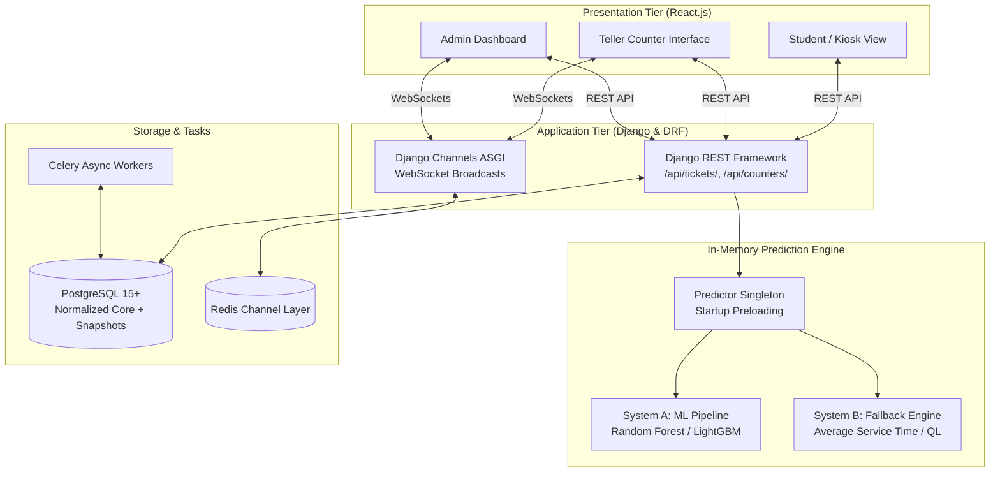

# ML-Time-predict-system

> **An End-to-End Machine-Learning Queue Waiting-Time Prediction & Real-Time Management System**  
> Built with operational queueing theory ($M/M/1$, $M/M/c$), Python (Scikit-Learn, Django REST Framework), PostgreSQL, and React.js.

---

## 📌 Project Overview

In service facilities such as university account sections, healthcare clinics, and banking halls, prolonged waiting lines and unpredictable delays lead to customer frustration and staff overload.

This repository implements a **dual-engine waiting-time prediction platform**:

- **System A (Primary ML Engine):** In-memory Scikit-Learn / Gradient Boosting regression pipeline delivering accurate, non-linear waiting-time estimates in **$\le 10$ milliseconds**.
- **System B (Deterministic Fallback):** Analytical Queue-Length ($\widehat{W}_{\text{QL}}$) and rolling Average Service Time (AST) formula ensuring zero-downtime availability.
- **Real-Time Client Tier:** Full-stack interface for self-service kiosks, student mobile tracking, teller counter operations, and administrative dashboards synchronized via WebSockets.

---

## 🏗️ System Architecture



---

## 🗂️ Repository Directory Structure

```
ML queue/
├── PLAN.md                                    # Master Implementation Plan (Phases 1-8, SLA, Architecture)
├── TASKS.md                                   # Actionable Task Checklist with priorities and checkboxes
├── WORK_BREAKDOWN_SCHEDULE.md                 # Formal WBS (1.0 - 8.0), Gantt schedule, and effort allocation
├── README.md                                  # Workspace overview and quickstart guide
├── main.py                                    # Python data ingestion scratch script
│
├── data/                                      # Queue datasets and data dictionary
│   ├── verified_queue_waiting_time_dataset.csv # Primary verified dataset (12,017 records, Oct 2026)
│   ├── queue_data.csv                         # Historical queue samples (560 rows)
│   ├── wait_times.csv                         # Multi-day logs
│   └── DataDictionary.xlsx                    # Field definitions and metadata
│
└── research/                                  # Comprehensive research documentation
    ├── README.md                              # Research index and cross-references
    ├── 00_queuing_theory_fundamentals_and_numerical_walkthrough.md # Little's Law & M/M/1 vs M/M/c analysis
    ├── 01_features_and_target_variables.md    # Feature taxonomy, leakage prevention, target formulations
    ├── 02_baseline_models_and_queueing_theory.md # Non-ML benchmarks (LES, HOL, AST, QL formulas)
    ├── 03_data_collection_protocol_college_queue.md # Observational protocol for unlogged queues
    ├── 04_database_design_and_entities.md     # Relational schema, snapshots, feature cache, ER diagram
    ├── 05_system_architecture_react_django_postgres.md # Full-stack topology and Celery workers
    ├── 06_django_ml_integration_guide.md      # Low-latency singleton serving in DRF (<= 10 ms)
    ├── 07_component_specifications.md         # Requirements for Frontend, Backend, Database, ML
    ├── 08_implementation_roadmap_and_schedule.md # 12-week Gantt schedule and CRISP-DM phases
    └── 09_project_kickoff_and_technology_selection.md # Why start with Data first, Django vs Node.js
```

---

## 📖 Quick Links & Documentation

### 📋 Project Planning & Management
- 📋 **Master Implementation Plan:** [`PLAN.md`](PLAN.md) — Vision, SLAs, 8-phase methodology, dual-engine fallback, and risk mitigations.
- ✅ **Actionable Task Checklist:** [`TASKS.md`](TASKS.md) — Prioritized checklist (`P0`, `P1`, `P2`) with status tracking and sprint focus.
- 📊 **Work Breakdown Structure & Schedule:** [`WORK_BREAKDOWN_SCHEDULE.md`](WORK_BREAKDOWN_SCHEDULE.md) — Formal WBS (1.0–8.0), 12-week Gantt schedule, and effort allocation.

### 🔬 Research & Theoretical Specifications (`research/`)
- 📚 **Research Repository Index:** [`research/README.md`](research/README.md)
- 📐 **00. Queuing Theory & M/M/1 Analysis:** [`00_queuing_theory_fundamentals_and_numerical_walkthrough.md`](research/00_queuing_theory_fundamentals_and_numerical_walkthrough.md)
- 🎯 **01. Feature Engineering & Target Variables:** [`01_features_and_target_variables.md`](research/01_features_and_target_variables.md)
- ⚖️ **02. Baseline Models & Benchmarks:** [`02_baseline_models_and_queueing_theory.md`](research/02_baseline_models_and_queueing_theory.md)
- 📝 **03. Data Collection Protocol (College Queue):** [`03_data_collection_protocol_college_queue.md`](research/03_data_collection_protocol_college_queue.md)
- 🗄️ **04. Database Schema & Entity Design:** [`04_database_design_and_entities.md`](research/04_database_design_and_entities.md)
- 🏛️ **05. System Architecture (React + Django + Postgres):** [`05_system_architecture_react_django_postgres.md`](research/05_system_architecture_react_django_postgres.md)
- ⚡ **06. Django ML Integration Guide ($\le 10$ ms):** [`06_django_ml_integration_guide.md`](research/06_django_ml_integration_guide.md)
- 📋 **07. Component Specifications:** [`07_component_specifications.md`](research/07_component_specifications.md)
- 📅 **08. Implementation Roadmap & Schedule:** [`08_implementation_roadmap_and_schedule.md`](research/08_implementation_roadmap_and_schedule.md)
- 🚀 **09. Project Kickoff & Technology Selection:** [`09_project_kickoff_and_technology_selection.md`](research/09_project_kickoff_and_technology_selection.md)

### 📊 Data Assets (`data/`)
- 📈 **Primary Verified Dataset:** [`data/verified_queue_waiting_time_dataset.csv`](data/verified_queue_waiting_time_dataset.csv) *(12,017 records, Oct 2026)*
- 📁 **Queue Sample Records:** [`data/queue_data.csv`](data/queue_data.csv) *(560 records)*
- ⏱️ **Wait Times Log:** [`data/wait_times.csv`](data/wait_times.csv) *(Multi-day logs)*
- 📗 **Data Dictionary:** [`data/DataDictionary.xlsx`](data/DataDictionary.xlsx) *(Schema metadata)*

### 🐍 Codebase Scripts
- 🐍 **Data Ingestion & Exploration Script:** [`main.py`](main.py)

---

## ⚡ Where to Start (Immediate Next Step)

As outlined in [research/09_project_kickoff_and_technology_selection.md](file:///c:/Users/Anupam%20Baral/Desktop/ML%20queue/research/09_project_kickoff_and_technology_selection.md):

**Start with Data Inspection and Baseline Prototyping in Python before writing any backend or frontend code!**

```bash
# 1. Activate your virtual environment
.venv\Scripts\activate

# 2. Inspect the verified dataset in data/
python -c "
import pandas as pd
df = pd.read_csv('data/verified_queue_waiting_time_dataset.csv')
print(df.info())
print(df.describe())
"
```
