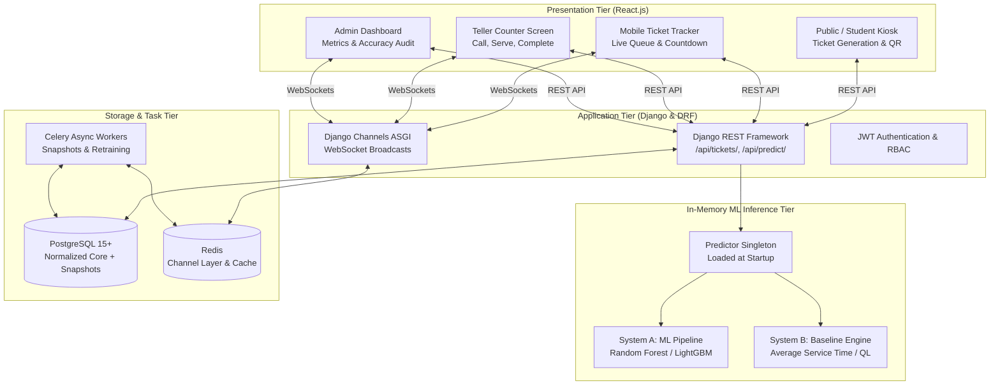

# System Architecture & Implementation Plan

> **System:** ML-Driven Queue Waiting-Time Prediction & Real-Time Management System  
> **Technology Stack:** React.js (Vite), Django REST Framework, PostgreSQL 15+, Scikit-Learn / XGBoost, Celery + Redis, WebSockets (Django Channels)  
> **Core Constraint:** In-memory prediction latency $\le 10$ milliseconds per ticket

---

## 1. System Architecture Overview



---

## 2. Dual-Engine Prediction Mechanism

To satisfy the strict **$\le 10\text{ ms}$ latency SLA** and guarantee 100% operational uptime:

```
Incoming Ticket Request (at arrival t_A)
              │
              ▼
   ┌───────────────────────────────────┐
   │ Check In-Memory Predictor Status  │
   └─────────────────┬─────────────────┘
                     │
         ┌───────────┴───────────┐
         ▼                       ▼
[Model Ready in Memory]     [Cold-Start or Error]
         │                       │
         ▼                       ▼
┌──────────────────┐    ┌───────────────────────────────────┐
│ System A: ML     │    │ System B: Baseline Engine         │
│ (Random Forest)  │    │ AST Formula / QL Estimator        │
│ Inference < 5 ms │    │ (Q(t) + 1) * AvgService / Servers │
└────────┬─────────┘    └─────────────────┬─────────────────┘
         │                                │
         └───────────────┬────────────────┘
                         ▼
           ┌───────────────────────────┐
           │ Return Estimated Wait Time│
           │ (Minutes & Seconds)       │
           └─────────────┬─────────────┘
                         ▼
           ┌───────────────────────────┐
           │ Log to prediction_logs    │
           │ for continuous auditing   │
           └───────────────────────────┘
```

1. **System A (Primary ML Model):**
   - Trained on historical arrival features: `queue_length`, `hour_of_day`, `day_of_week`, `is_weekend`, `last_served_wait`.
   - Preloaded directly into Python memory as a singleton upon Django server boot (`AppConfig.ready()`).
   - Evaluates predictions in $< 5\text{ ms}$ without inter-process communication overhead.
2. **System B (Deterministic Fallback Engine):**
   - Pure analytical queue formula:
     $$\widehat{W}_{\text{AST}} = \frac{(Q(t) + 1) \cdot \overline{S}_{\text{category}}}{c_{\text{active}}}$$
   - Guarantees that if the ML pipeline encounters unseen input values or missing columns, the user receives an instantaneous, mathematically sound estimate without API failure.

---

## 3. Data Pipeline & Strict Leakage Prevention

A fundamental architectural requirement is separating what is known at the moment of arrival ($t_A$) from future events:

```
Arrival Epoch (t_A)
│
├── [ALLOWED FEATURES] ─────────────────────────────────────────────┐
│   ✔ Current Queue Length ahead (L_q)                             │
│   ✔ Active Server Count (c)                                      │
│   ✔ Hour of the Day (0-23) & Day of Week (0-6)                   │
│   ✔ Delay of the Last-To-Enter-Service customer (LES)            │
│   ✔ Rolling 7-day Average Service Time (AST)                     │
└───┬───────────────────────────────────────────────────────────────┘
    │
    ▼ [WAITING DURATION: W_q (TARGET TO PREDICT)]
    │
Service Start Epoch (t_S)
│
├── [FORBIDDEN AT t_A - DATA LEAKAGE] ──────────────────────────────┐
│   ✖ Service Duration of this customer (S = t_D - t_S)            │
│   ✖ Exact departure timestamp (t_D)                              │
│   ✖ Future arrivals joining queue after t_A                      │
│   ✖ Downstream administrative interruptions or breaks            │
└───┬───────────────────────────────────────────────────────────────┘
    │
    ▼ [SERVICE DURATION: S]
    │
Service Finish Epoch (t_D)
```

---

## 4. Eight-Phase Delivery Roadmap

```
[Phase 1: Framing & SLAs] ──► [Phase 2: Data Audit & Cleaning]
                                       │
                                       ▼
                              [Phase 3: Preprocessing & Feature Extraction]
                                       │
                   ┌───────────────────┴───────────────────┐
                   ▼                                       ▼
        [Phase 4: Baselines]                    [Phase 6: PostgreSQL Setup]
                   │                                       │
                   ▼                                       │
        [Phase 5: ML Models]                               │
                   │                                       │
                   └───────────────────┬───────────────────┘
                                       ▼
                            [Phase 7: DRF API Serving]
                                       │
                                       ▼
                            [Phase 8: React UI & MLOps]
```

---

## 5. Key Milestones

| Milestone | Phase | Description | Success Gate |
|---|---|---|---|
| **M1** | Phase 1 | Project Charter & SLA Specification | $\le 10$ ms latency & $\ge 15\%$ improvement hurdle defined. |
| **M2** | Phase 2 | Raw Dataset Audited & Cleaned | 12,017 records validated; zero negative wait times. |
| **M3** | Phase 3 | Leakage-Free Feature Matrix | Features derived strictly at $t_A$; chronological 80/20 partition. |
| **M4** | Phase 4 | Baseline Evaluation Suite | Historical Mean, LES, and AST benchmark errors computed. |
| **M5** | Phase 6 | PostgreSQL Deployed & Seeded | Normalized tables created with partial indexes for active queues. |
| **M6** | Phase 5 | Serialized Model Artifact | Candidate model achieves $\ge 15\%$ MAE improvement; saved to `.joblib`. |
| **M7** | Phase 7 | Low-Latency Serving API | DRF endpoints `/api/tickets/` with dual-engine fallback ($\le 10$ ms). |
| **M8** | Phase 8 | Live System with WebSockets | Full-stack React interfaces with real-time queue synchronization. |
