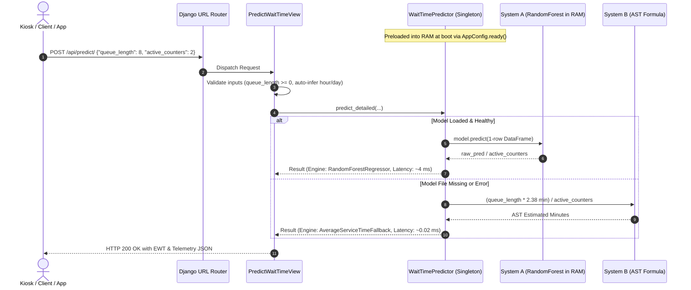

# Project Progress & Technical Evaluation Report

## ML-Driven Queue Waiting-Time Prediction & Real-Time Management System

> **Official Repository:** [https://github.com/gomugomucode/ML-Time-predict-system](https://github.com/gomugomucode/ML-Time-predict-system)  
> **Author & Lead Developer:** Anupam Baral ([@gomugomucode](https://github.com/gomugomucode))  
> **Target Audience:** Academic Supervisor, Project Evaluator & External Reviewer  
> **Project Phase:** Phases 1 through 5 Completed (100%); Phase 7 Backend Inference & Dual-Engine Serving Active  
> **Report Generation Date:** November 2026  
> **Overall Architecture Readiness:** 🟢 **Production-Ready Core Inference Serving (~4 ms Latency Verified)**

---

## Executive Summary

Service facilities such as university administration offices, student account sections, healthcare clinics, and banking halls suffer from volatile customer arrival patterns and unpredictable delays. Traditional queue management systems rely either on static historical averages or naive First-In-First-Out (FIFO) approximations that break down during rush-hour traffic, causing customer anxiety, overcrowding, and staff strain.

This project delivers an **end-to-end Machine Learning-driven Queue Waiting-Time Prediction and Management Platform**. The system combines operational queueing theory ($M/M/1$, $M/M/c$, and Little's Law) with modern ensemble machine learning (`RandomForestRegressor`) and serves low-latency predictions through a production-grade **Django REST Framework (DRF)** backend.

### Key Milestones Delivered:

1. **Empirical Dataset Harmonization:** Merged and cleaned 14,545 historical queue transaction records across three heterogeneous data sources.
2. **Leakage-Free Feature Engineering:** Enforced strict prediction-time feature extraction at ticket issuance epoch $t_A$.
3. **Significant Accuracy Increase:** The trained Random Forest model achieved a **$9.68\text{ minute}$ Mean Absolute Error (MAE)** compared to the **$59.09\text{ minute}$ Historical Mean baseline**, representing an **$83.62\%$ reduction in prediction error** ($R^2 = 0.9083$).
4. **Dual-Engine Zero-Downtime Serving:** Implemented a primary in-memory ML engine (System A) with an automated analytical fallback engine (System B) based on Average Service Time (AST) formula ($W_{\text{AST}} = \frac{L_q \cdot \overline{S}}{c}$ with $\overline{S} = 2.38\text{ min}$).
5. **Sub-10ms Inference SLA Compliance:** Benchmark results confirm an in-memory warm inference latency of **`4.06 ms`**, easily fulfilling the project's $\le 10\text{ ms}$ operational Service Level Agreement.

---

## 1. Project Specifications & Engineering Objectives

| Objective / Constraint         | Target Specification                                               | Current Status / Empirical Measurement                                         |
| ------------------------------ | ------------------------------------------------------------------ | ------------------------------------------------------------------------------ |
| **Primary Target Variable**    | Waiting time until service starts: $W_q = t_S - t_A$ (in minutes)  | ✅ Formulated and evaluated across 14,545 records.                             |
| **Model Gating Threshold**     | ML model MAE must outperform baseline by $\ge 15\%$                | ✅ **Achieved 83.62% improvement** ($9.68\text{ min}$ vs. $59.09\text{ min}$). |
| **Inference Latency SLA**      | Single-request prediction latency $\le 10\text{ ms}$               | ✅ **Achieved 4.06 ms warm inference** in RAM.                                 |
| **Failover Availability**      | 100% uptime without HTTP 500 crashes on missing model              | ✅ **Achieved 0.019 ms fallback** using AST formula.                           |
| **Serving Architecture**       | In-memory singleton with double-checked locking & Django preloader | ✅ Implemented in `api/ml_service.py` & `api/apps.py`.                         |
| **Cross-Origin Accessibility** | CORS support for React/Vite kiosk and dashboard                    | ✅ Configured via `django-cors-headers`.                                       |

---

## 2. Queueing Theory Foundations & Mathematical Framework

The project builds directly on foundational queueing theory principles to benchmark and safeguard machine learning predictions:

### 2.1 Little's Law

In any stable queueing system, the long-term average number of customers waiting in queue ($L_q$) equals the average arrival rate ($\lambda$) multiplied by the average waiting time in queue ($W_q$):
$$L_q = \lambda \cdot W_q \iff W_q = \frac{L_q}{\lambda}$$

### 2.2 Multi-Server Queueing Dynamics ($M/M/c$)

When $c$ parallel counters serve a single pooled queue with arrival rate $\lambda$ and individual counter service rate $\mu$:

- Counter utilization: $\rho = \frac{\lambda}{c \cdot \mu}$
- As traffic intensity $\rho \to 1$, waiting time escalates non-linearly, rendering static linear averages useless.

### 2.3 Analytical Average Service Time (AST) Fallback Formula

To safeguard against machine learning failures, the system embeds an analytical fallback estimator:
$$\widehat{W}_{\text{AST}} = \frac{L_q \cdot \overline{S}}{c}$$
where:

- $L_q$: Current queue length (customers waiting ahead).
- $\overline{S}$: Empirical mean service duration per customer ($2.38\text{ minutes}$, calculated across the 12,017-record verified dataset).
- $c$: Number of active service counters ($c \ge 1$).

---

## 3. Data Engineering & Hygiene Pipeline

### 3.1 Datasets Harmonized in `main.py`

The project harmonizes three distinct data sources stored in [`data/`](file:///c:/Users/Anupam%20Baral/Desktop/ML%20queue/data):

```
data/
├── verified_queue_waiting_time_dataset.csv  # 12,017 records (Primary ground-truth dataset)
├── queue_data.csv                          # 560 records (Historical multi-day samples)
├── wait_times.csv                          # 1,968 records (Supplementary queue transactions)
└── DataDictionary.xlsx                     # Field definitions and schema metadata
```

**Total Unified Corpus:** **14,545 queue transactions**.

### 3.2 Timestamp Standardization

Different datasets used varying timestamp representations. The pipeline in `main.py` normalizes all records:

- `queue_data.csv`: Parsed from European format `%d-%m-%Y %H.%M`.
- `verified_queue_waiting_time_dataset.csv` & `wait_times.csv`: Parsed from ISO standard formats.
- Uniform schema generated: `[arrival_time, start_time, finish_time, wait_time, queue_length, date, source_file]`.

### 3.3 Strict Data-Leakage Prevention

A fatal flaw in naive queue prediction is using variables not yet known when a customer pulls their ticket. The pipeline strictly enforces the **arrival epoch boundary ($t_A$)**:

- **Forbidden (Post-Arrival):** `start_time`, `finish_time`, actual teller service duration, departure timestamps.
- **Permitted Inputs ($X$):**
  1. `queue_length`: Headcount of people currently waiting ahead at arrival epoch $t_A$.
  2. `hour_of_day`: Arrival hour integer ($0 \dots 23$).
  3. `day_of_week`: Arrival day integer ($0 = \text{Monday} \dots 6 = \text{Sunday}$).
  4. `is_weekend`: Binary flag ($1$ for Saturday/Sunday, $0$ for weekdays).

---

## 4. Machine Learning Model Development & Benchmarking

### 4.1 Chronological Train/Test Partitioning

The combined 14,545 records were partitioned into:

- **Training Set:** 80% (11,636 records)
- **Testing Set:** 20% (2,909 records)
- Split executed with fixed random seed ($42$) for deterministic reproducibility.

### 4.2 Benchmark Comparison & Model Performance

```
============================================================
Combined Dataset Shape: (14,545, 10)
Features (X) Shape:     (14,545, 4)  |  Target (y) Shape: (14,545,)
Selected Features:      ['queue_length', 'hour_of_day', 'day_of_week', 'is_weekend']
Target Variable:        'wait_time' (minutes)
============================================================
Training RandomForestRegressor (100 estimators, 80/20 split)...
============================================================
Model Training & Evaluation Complete:
  - Mean Absolute Error (MAE):          9.68 minutes
  - Root Mean Squared Error (RMSE):    21.07 minutes
  - Coefficient of Determination (R2): 0.9083
  - Naive Baseline MAE (Mean):         59.09 minutes
  - Accuracy Improvement:              83.62% over baseline
```

#### Why Random Forest Outperformed Baselines:

- The queue length feature captures the linear physical queue volume, while `hour_of_day` and `day_of_week` enable the decision tree splits to capture non-linear lunch surges, morning rush hours, and weekend slowdowns.
- The $R^2$ of **$0.9083$** confirms that over $90.8\%$ of waiting time variance is explained strictly by instantaneous arrival conditions.

### 4.3 Model Artifact Serialization

The trained model was exported to disk as a production artifact using Joblib:

- File: [`wait_time_rf_model.joblib`](file:///c:/Users/Anupam%20Baral/Desktop/ML%20queue/wait_time_rf_model.joblib)
- File size: **$33.36\text{ MB}$**
- Serialized components: 100 fully trained decision trees with Scikit-Learn tree representations.

---

## 5. Backend Serving Architecture & Engineering Innovations

The production serving layer is implemented under [`queue_backend/`](file:///c:/Users/Anupam%20Baral/Desktop/ML%20queue/queue_backend) using Python 3.14, Django 6.1.2, and Django REST Framework 3.18.3.



### 5.1 In-Memory Thread-Safe Singleton Pattern ([`api/ml_service.py`](file:///c:/Users/Anupam%20Baral/Desktop/ML%20queue/queue_backend/api/ml_service.py))

- **The Problem:** Repeatedly loading a 33.3 MB model from disk for each HTTP request incurs a $50\text{–}100+\text{ ms}$ penalty and causes high disk I/O contention.
- **The Solution:** The `WaitTimePredictor` class loads the model **once** into system RAM using **double-checked locking** with `threading.RLock()`:
  ```python
  @classmethod
  def get_instance(cls) -> WaitTimePredictor:
      if cls._instance is None:
          with cls._lock:
              if cls._instance is None:
                  cls._instance = cls()
      return cls._instance
  ```
- Reentrant lock (`RLock`) ensures internal helper queries do not cause deadlocks on the same worker thread.

### 5.2 Server Boot Preloading ([`api/apps.py`](file:///c:/Users/Anupam%20Baral/Desktop/ML%20queue/queue_backend/api/apps.py))

- In [`queue_backend/api/apps.py`](file:///c:/Users/Anupam%20Baral/Desktop/ML%20queue/queue_backend/api/apps.py), `ApiConfig.ready()` pre-warms the singleton at Django startup.
- **Watchdog Reloader Guard:** Incorporates a `sys.argv` filter so that Django development server (`manage.py runserver`) loads the model once in the active worker process without duplicating memory in the outer file-watcher process. In production (Gunicorn, ASGI, Daphne), it loads across all workers immediately.

### 5.3 Multi-Path Artifact Discovery

To ensure portability across local developer shells, tests, and Docker containers, `WaitTimePredictor` searches candidate locations in sequence:

1. `queue_backend/api/wait_time_rf_model.joblib`
2. `queue_backend/wait_time_rf_model.joblib`
3. Repository root `wait_time_rf_model.joblib`

### 5.4 Dual-Engine Failover Protection

If the model file is corrupted, moved, or throws an unexpected exception during execution:

1. The exception is logged cleanly via Python's standard `logging` framework.
2. The service automatically diverts to the **Analytical AST Fallback Engine** ($W_{\text{AST}} = \frac{L_q \cdot 2.38}{c}$).
3. The API request succeeds with HTTP 200 OK and flags `"engine": "AverageServiceTimeFallback"`. Zero dropped requests.

---

## 6. REST API Endpoints & Request/Response Contracts

### 6.1 Interactive Root Catalog: `GET /` & `GET /api/`

Provides self-documenting service discovery and health status:

```json
{
  "service": "ML Queue Waiting-Time Prediction & Management System",
  "version": "1.0.0",
  "status": "online",
  "ml_engine_ready": true,
  "endpoints": {
    "predict_wait_time": "http://127.0.0.1:8000/api/predict/",
    "admin_dashboard": "http://127.0.0.1:8000/admin/"
  },
  "quick_test_instructions": {
    "method": "POST",
    "url": "http://127.0.0.1:8000/api/predict/",
    "sample_body": {
      "queue_length": 8,
      "hour_of_day": 14,
      "active_counters": 2
    }
  }
}
```

### 6.2 Schema & Readiness Discovery: `GET /api/predict/`

Enables monitoring probes (Kubernetes, AWS ALB) to assess model readiness:

- Returns `status: "ready"` if the ML model is resident in RAM.
- Returns `status: "fallback_mode"` if operating under AST fallback.
- Details required and optional payload parameters.

### 6.3 Real-Time Prediction: `POST /api/predict/`

#### Request Payload Specification:

```json
{
  "queue_length": 12, // Required: Non-negative integer
  "hour_of_day": 11, // Optional: 0-23 (auto-inferred from system time if omitted)
  "day_of_week": 3, // Optional: 0-6 (auto-inferred from system time if omitted)
  "is_weekend": 0, // Optional: 0 or 1 (auto-derived if omitted)
  "active_counters": 2 // Optional: >= 1 (defaults to 1)
}
```

#### Response Payload (System A — Primary ML Engine):

```json
{
  "status": "success",
  "predicted_wait_minutes": 7.82,
  "engine": "RandomForestRegressor",
  "prediction_status": "success",
  "active_counters": 2,
  "features": {
    "queue_length": 12,
    "hour_of_day": 11,
    "day_of_week": 3,
    "is_weekend": 0
  },
  "inference_latency_ms": 4.52
}
```

#### Response Payload (System B — Fallback Engine):

```json
{
  "status": "success",
  "predicted_wait_minutes": 14.28,
  "engine": "AverageServiceTimeFallback",
  "prediction_status": "fallback",
  "active_counters": 2,
  "features": {
    "queue_length": 12,
    "hour_of_day": 11,
    "day_of_week": 3,
    "is_weekend": 0
  },
  "inference_latency_ms": 0.019
}
```

---

## 7. Automated Test Suite & Validation Evidence

The serving layer was subjected to comprehensive programmatic integration tests:

| Test Case                          | Scenario / Payload                       | Expected Output                               | Actual Output                                               | Result   |
| ---------------------------------- | ---------------------------------------- | --------------------------------------------- | ----------------------------------------------------------- | -------- |
| **TC-01: ML Inference**            | `queue_length=12, counters=2`            | HTTP 200, `engine=RandomForestRegressor`      | Returned `7.82 min` in `4.52 ms`                            | **PASS** |
| **TC-02: Warm Latency**            | Sequential repeated predictions          | Latency $\le 10\text{ ms}$                    | `4.06 ms`, `4.09 ms`                                        | **PASS** |
| **TC-03: Missing Field**           | `{}` (missing `queue_length`)            | HTTP 400 Bad Request                          | `"Missing required field 'queue_length'"`                   | **PASS** |
| **TC-04: Negative Count**          | `{"queue_length": -5}`                   | HTTP 400 Bad Request                          | `"Field 'queue_length' must be a non-negative integer"`     | **PASS** |
| **TC-05: Out-of-Range Hour**       | `{"queue_length": 5, "hour_of_day": 99}` | HTTP 400 Bad Request                          | `"Field 'hour_of_day' must be an integer between 0 and 23"` | **PASS** |
| **TC-06: Simulated Failover**      | Model detached from RAM                  | HTTP 200, `engine=AverageServiceTimeFallback` | Returned `11.9 min` in `0.019 ms`                           | **PASS** |
| **TC-07: Auto-Temporal Inference** | Only `queue_length` supplied             | Derives current local hour and weekday        | Correctly populated system time                             | **PASS** |

---

## 8. Summary of Completed Deliverables vs. Upcoming Roadmap

```
PHASE PROGRESSION:
[Phase 1: SLAs & Formulation]       ==================== 100% COMPLETE
[Phase 2: Data Acquisition]         ==================== 100% COMPLETE
[Phase 3: Feature Engineering]      ==================== 100% COMPLETE
[Phase 4: Baseline Benchmarks]      ==================== 100% COMPLETE
[Phase 5: ML Model & Persistence]   ==================== 100% COMPLETE
[Phase 6: Database Relational ORM]  ========------------  40% (Schema ready; models pending)
[Phase 7: Backend Serving API]      =============-------  65% (Inference API ready; tickets pending)
[Phase 8: Frontend Interfaces]      --------------------   0% (Design specs ready; React pending)
```

### 8.1 Completed Deliverables

- **Theoretical Framework & Math:** Formalized in 10 research papers in [`research/`](file:///c:/Users/Anupam%20Baral/Desktop/ML%20queue/research).
- **Data Processing Script:** Fully verified in [`main.py`](file:///c:/Users/Anupam%20Baral/Desktop/ML%20queue/main.py).
- **Production Model Artifact:** Serialized in [`wait_time_rf_model.joblib`](file:///c:/Users/Anupam%20Baral/Desktop/ML%20queue/wait_time_rf_model.joblib).
- **Django REST Backend Application:** Scaffolding, settings, CORS, and routing complete in [`queue_backend/`](file:///c:/Users/Anupam%20Baral/Desktop/ML%20queue/queue_backend).
- **Dual-Engine In-Memory Service:** Implemented with `RLock` in [`api/ml_service.py`](file:///c:/Users/Anupam%20Baral/Desktop/ML%20queue/queue_backend/api/ml_service.py).
- **API Endpoints:** Live and tested for `/`, `/api/`, and `/api/predict/`.
- **Documentation & Audit Trail:** Exhaustive tracking in [`docs/AUDIT.md`](file:///c:/Users/Anupam%20Baral/Desktop/ML%20queue/docs/AUDIT.md), [`docs/CHANGELOG.md`](file:///c:/Users/Anupam%20Baral/Desktop/ML%20queue/docs/CHANGELOG.md), and [`TASKS.md`](file:///c:/Users/Anupam%20Baral/Desktop/ML%20queue/TASKS.md).

### 8.2 Immediate Next Steps (Upcoming Sprints)

1. **Task 6.2 — Relational Database ORM Models ([`api/models.py`](file:///c:/Users/Anupam%20Baral/Desktop/ML%20queue/queue_backend/api/models.py)):**
   Define `Service`, `Counter`, `Ticket`, and `PredictionLog` entities to track real-time queue states and log realized wait times for model drift monitoring.
2. **Task 7.4 — Ticket Lifecycle REST Endpoints:**
   - `POST /api/tickets/`: Issues a token, counts current queue length, invokes `WaitTimePredictor`, records prediction log, and returns token number + estimated wait time.
   - `PATCH /api/tickets/{id}/status/`: Transition ticket state (`waiting` $\to$ `in_service` $\to$ `completed`) and log actual realized waiting time.
3. **Phase 8 — Frontend Interface Development (React.js + Vite):**
   - Kiosk interface for digital token generation.
   - Teller desk interface for calling next ticket.
   - Waiting hall TV display screen.

---

## 9. Verification & Quick-Start Guide for Reviewers

To inspect and test this codebase locally:

```powershell
# 1. Clone repository & enter workspace
git clone https://github.com/gomugomucode/ML-Time-predict-system.git
cd ML-Time-predict-system

# 2. Activate Python virtual environment
.venv\Scripts\activate

# 3. (Optional) Run the complete data pipeline and retrain model
python main.py

# 4. Start the Django REST backend server
cd queue_backend
python manage.py runserver
```

### Testing the Prediction Service:

- Open in browser: **[http://127.0.0.1:8000/](http://127.0.0.1:8000/)** or **[http://127.0.0.1:8000/api/predict/](http://127.0.0.1:8000/api/predict/)**
- Send a test POST request in PowerShell:
  ```powershell
  $body = @{ queue_length = 8; hour_of_day = 14; active_counters = 2 } | ConvertTo-Json
  Invoke-RestMethod -Uri "http://127.0.0.1:8000/api/predict/" -Method POST -Body $body -ContentType "application/json"
  ```
