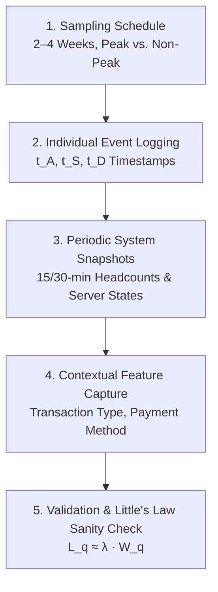

# 03. Data Collection Protocol: College Account-Section Queue

When a service facility (such as a college account section, administration counter, or fee clearance desk) has no historical arrival timestamps, empirical queueing studies require a structured observational field study. This document defines the end-to-end data collection protocol, validation methods, and observational logging templates.

---

## 1. Context & Operational Constraints

In collegiate administrative offices:
- **Arrival times ($t_A$) are rarely logged**; administrative receipts only capture the transaction completion time ($t_D$).
- **Demand exhibits extreme seasonality:** Normal lecture weeks experience light walk-in traffic, whereas fee-payment deadlines, scholarship verification, and exam registration create extreme congestion bursts.
- **Service times vary widely** based on transaction type (e.g., simple inquiry vs. multi-year fee reconciliation).

---

## 2. Five-Stage Observational Protocol



### Stage 1: Observation Framework & Sampling Schedule
- **Study Duration:** Minimum continuous period of **2 to 4 weeks** during operating hours (e.g., 08:00 to 16:00).
- **Academic Calendar Coverage:**
  - *Baseline Days:* 2 regular weeks during semester lectures (low-to-moderate traffic).
  - *Peak Days:* 1–2 weeks coinciding with tuition fee deadlines, examination admit card issuance, or scholarship verification.
- **Staffing & Tools:** 1–2 trained student or staff observers positioned with an unobstructed line-of-sight to the queue entry point and teller counters, using synchronized digital stopwatches or timestamping web apps.

---

### Stage 2: Individual-Level Event Logging (Primary Ground Truth)
For every individual student entering the account section, record three primary epochs to the nearest second:

1. **Arrival Epoch ($t_A$):** The exact instant the student steps into the waiting area and joins the queue.
2. **Service Start Epoch ($t_S$):** The instant the teller acknowledges the student, calls them to the window, and begins processing.
3. **Service Completion / Departure Epoch ($t_D$):** The instant the transaction concludes, receipt/documents are handed over, and the student departs the window.

#### Derived Metrics per Student $i$:
- **Inter-Arrival Time:** $\Delta t_{A, i} = t_{A, i} - t_{A, i-1}$
- **Queue Waiting Time:** $W_{q, i} = t_{S, i} - t_{A, i}$
- **Service Duration:** $S_i = t_{D, i} - t_{S, i}$
- **Total System / Sojourn Time:** $W_{s, i} = t_{D, i} - t_{A, i} = W_{q, i} + S_i$

---

### Stage 3: Periodic System-State Snapshots
At fixed intervals (**every 15 or 30 minutes**), observers record macroscopic facility metrics:
- **Physical Queue Length ($L_q$):** Instantaneous headcount of students physically waiting in line.
- **Active Counter Count ($c$):** Number of functioning teller windows actively serving or available.
- **Server Status Breakdown:**
  - Active / Serving
  - Idle (open counter, waiting for student to step up)
  - Staff break / administrative paperwork processing (counter closed)
- **Balking Count:** Students who arrive, observe the long line, and leave without joining.
- **Reneging Count:** Students who joined the queue but abandoned before reaching the counter.

---

### Stage 4: Categorical & Contextual Feature Capture

For each transaction, capture contextual metadata that dictates service duration:

| Field | Categories / Values | Notes |
|---|---|---|
| **Transaction Category** | Tuition Fee Deposit, Exam Fee, Fine / Clearance, Scholarship Disbursement, General Inquiry | Primary variance driver |
| **Payment Instrument** | Cash, Bank Demand Draft (DD), POS Debit/Credit Card, Online Voucher Verification | DD/Cash require cash-counting |
| **Student Year / Level** | Freshman (1st Year), Continuing (2nd–4th Year), Postgraduate | 1st-year students take longer |
| **Queue Discipline** | Standard FCFS, Priority Bypass (faculty, disabled, emergency) | Captures order violations |
| **Shift / Period** | Morning (08:00–11:30), Mid-day Handover (11:30–13:00), Afternoon (13:00–16:00) | Fatigue & staffing effects |

---

### Stage 5: Data Hygiene, Quality Control & Little's Law Sanity Check

1. **Filtering Anomalies:**
   - Drop entries where $t_S < t_A$ or $t_D < t_S$ (negative intervals caused by recording error).
   - Filter extreme outliers using the Interquartile Range (IQR) rule:
     $$\text{Drop if } W_q > Q_3 + 3 \times \text{IQR}$$
2. **Distribution Fitting & Goodness-of-Fit Tests:**
   - Test inter-arrival intervals $\Delta t_A$ against an **Exponential distribution** using Kolmogorov-Smirnov (KS) tests or Chi-Square tests to verify Poisson arrival behavior ($\lambda$).
   - Test service durations $S$ against **Exponential, Erlang-k, and Lognormal distributions**.
3. **Sanity Check via Little's Law:**
   Verify internal consistency of the observational dataset by evaluating:
   $$L_q \approx \lambda \cdot W_q \quad \text{and} \quad L \approx \lambda \cdot W_s$$
   $$\text{Where: } \lambda = \frac{N_{\text{total}}}{T_{\text{observation}}}, \quad \overline{W}_q = \frac{1}{N}\sum W_{q, i}$$
   *If the directly observed headcount $L_q$ diverges from $\lambda \cdot \overline{W}_q$ by more than 15–20%, check for unlogged server downtime, unrecorded dropouts (reneging), or missing arrival bursts.*

---

## 3. Printable Field Observation Sheet Template

```
=============================================================================================================
COLLEGE ACCOUNT SECTION QUEUE OBSERVATION LOG
Date: ______________  Observer Name: _____________________  Shift: [ ] Morning  [ ] Afternoon
=============================================================================================================
Token /  Arrival   Service Start  Departure   Transaction   Payment    Counter #  Balk/Reneg  Notes
ID       (t_A)     (t_S)          (t_D)       Type          Method                Flag
-------------------------------------------------------------------------------------------------------------
001      09:02:14  09:08:30       09:12:10    Tuition Fee   Card       Counter 1  No
002      09:03:05  09:12:15       09:14:45    Exam Fee      Cash       Counter 1  No
003      09:04:10  ---            ---         Inquiry       ---        ---        Balked      Left after 1m
004      09:05:40  09:11:00       09:19:20    Scholarship   DD         Counter 2  No
...
=============================================================================================================
PERIODIC SNAPSHOT (Every 30 Minutes):
Time      Queue Length (L_q)  Active Counters (c)  Idle Counters  Notes
-------------------------------------------------------------------------------------------------------------
09:30     7                   2                    0              Counter 3 staff on 15m break
10:00     14                  3                    0              Fee deadline rush started
=============================================================================================================
```

---

## 4. Python Data Validation & Little's Law Check Script

```python
import numpy as np
import pandas as pd
from scipy import stats


def validate_queue_observations(df: pd.DataFrame, observation_hours: float):
  """Validates raw queue observation log and tests Little's Law consistency."""
  # Calculate durations in minutes
  df["inter_arrival_min"] = (
      df["arrival_dt"].diff().dt.total_seconds().div(60.0)
  )
  df["waiting_time_min"] = (
      (df["service_start_dt"] - df["arrival_dt"])
      .dt.total_seconds()
      .div(60.0)
  )
  df["service_duration_min"] = (
      (df["departure_dt"] - df["service_start_dt"])
      .dt.total_seconds()
      .div(60.0)
  )

  # 1. Hygiene checks
  invalid = df[
      (df["waiting_time_min"] < 0) | (df["service_duration_min"] <= 0)
  ]
  print(f"Data Hygiene: Found {len(invalid)} invalid negative-duration rows.")

  # 2. Empirical Rates
  total_served = len(df[df["service_start_dt"].notnull()])
  arrival_rate_lambda = total_served / (
      observation_hours * 60.0
  )  # arrivals/minute
  mean_wq = df["waiting_time_min"].mean()
  mean_s = df["service_duration_min"].mean()
  service_rate_mu = 1.0 / mean_s if mean_s > 0 else 0.0

  # 3. Little's Law Sanity Check
  theoretical_lq = arrival_rate_lambda * mean_wq
  empirical_lq = df["observed_queue_length_at_arrival"].mean()

  print("\n--- QUEUEING SYSTEM ESTIMATES ---")
  print(f"Arrival Rate (lambda): {arrival_rate_lambda:.4f} arrivals/min")
  print(f"Service Rate (mu)    : {service_rate_mu:.4f} services/min/counter")
  print(f"Mean Wait Time (W_q) : {mean_wq:.2f} minutes")
  print(f"Mean Service Time (S): {mean_s:.2f} minutes")
  print(f"Calculated L_q (lambda * W_q): {theoretical_lq:.2f} students")
  print(f"Observed Headcount L_q       : {empirical_lq:.2f} students")

  discrepancy_pct = (
      abs(theoretical_lq - empirical_lq) / max(empirical_lq, 1e-5)
  ) * 100
  print(f"Little's Law Discrepancy     : {discrepancy_pct:.2f}%")

  # 4. Exponential Inter-arrival Goodness-of-Fit (Kolmogorov-Smirnov Test)
  clean_intervals = df["inter_arrival_min"].dropna()
  scale_param = clean_intervals.mean()
  ks_stat, p_val = stats.kstest(
      clean_intervals, "expon", args=(0, scale_param)
  )
  print("\n--- DISTRIBUTION TESTING (Inter-arrivals) ---")
  print(f"Exponential KS Statistic: {ks_stat:.4f}, p-value: {p_val:.4f}")
  if p_val > 0.05:
    print(
        "Result: Fail to reject null hypothesis — inter-arrivals follow a"
        " Poisson process (exponential inter-arrival times)."
    )
  else:
    print(
        "Result: Inter-arrivals deviate from pure Poisson behavior (common in"
        " bursty student queues)."
    )
```
