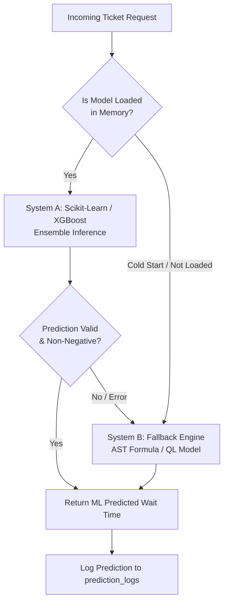

# 05. System Architecture: React + Django REST + PostgreSQL

This document defines the production system architecture for the queue management and waiting-time prediction platform, integrating a **React.js** presentation tier, a **Django REST Framework (DRF)** orchestration tier with **Django Channels (WebSockets)**, a **PostgreSQL 15+** data tier, and an **in-memory scikit-learn / XGBoost ML dual-engine**.

---

## 1. System Topology

```
+-----------------------------------------------------------------------------------+
|                            PRESENTATION TIER (React.js)                           |
|  +--------------------+     +---------------------+     +----------------------+  |
|  |  Student / Kiosk   |     |   Teller Counter    |     |    Administrator     |  |
|  |  Queue View & QR   |     |   Call & Serve UI   |     |  Dashboard & Metrics |  |
|  +---------+----------+     +----------+----------+     +-----------+----------+  |
+------------|---------------------------|----------------------------|-------------+
             | REST APIs                 | WebSocket (Live Events)    | REST / WS
             v                           v                            v
+-----------------------------------------------------------------------------------+
|               APPLICATION & ORCHESTRATION TIER (Django & DRF)                    |
|  +-----------------------------------------------------------------------------+  |
|  | ASGI / Django Channels Layer (WebSockets: queue:updated, ticket:called)     |  |
|  +-----------------------------------------------------------------------------+  |
|  | DRF API Views & Serializers                                                 |  |
|  |   - Auth & RBAC (/api/auth/)            - Queue Flow (/api/tickets/)        |  |
|  |   - Counter Routing (/api/counters/)    - Prediction Engine (/api/predict/) |  |
|  +-----------------------------------------------------------------------------+  |
|  | Service Layer: Feature Extraction Pipeline & Queue-Length Estimators        |  |
+------------+--------------------------------------------------------+-------------+
             |                                                        |
             | Tasks & Events                                         | SQL Queries / ORM
             v                                                        v
+---------------------------+             +-----------------------------------------+
| ASYNC WORKERS (Celery)    |             |       DATA TIER (PostgreSQL 15+)        |
| - Snapshot Aggregations   |             | - Core Tables (Tickets, Counters)       |
| - Delay-History Caching   |             | - Queue Status Snapshots (Per-minute)   |
| - Model Retraining Tasks  |             | - Prediction Logs & Model Registry      |
+-------------+-------------+             +-----------------------------------------+
              | Loads / Evaluates
              v
+-----------------------------------------------------------------------------------+
|                      ML INFERENCE & DUAL-ENGINE SERVICE                           |
|  - System A: Serialized Scikit-learn / XGBoost Ensemble Model (Latency <= 10 ms)  |
|  - System B: Baseline Engine Fallback (AST / Analytical Queue-Length Model)       |
+-----------------------------------------------------------------------------------+
```

---

## 2. Presentation Tier (React.js)

The client tier is built with React.js and delivers responsive, role-based views designed to minimize perceived waiting times:

### A. Student / Public Kiosk Portal
- **Digital Check-In & Virtual Queueing:** Allows students to generate a ticket via self-service kiosk or scan a QR code on mobile devices to join the queue virtually.
- **Real-Time Turn Tracking:** Displays current serving token, personal queue position, and dynamic **Estimated Waiting Time (EWT)**.
- **Stage Breakdown:** For multi-step administrative processes (e.g., Accounts $\rightarrow$ Verification), breaks down estimated wait and processing times per stage.

### B. Teller Counter Interface
- **Calling Controls:** Staff call the next student, mark service initiation ($t_S$), finalize completion ($t_D$), or flag no-shows/dropouts (`balked` / `reneged`).
- **Counter Workload View:** Shows active line depth, waiting tickets assigned to that counter's skill mapping, and queue trends.

### C. Administrative Dashboard
- **Macro Queue Metrics:** Displays live queue length ($L_q$), average wait time ($W_q$), empirical arrival rate ($\lambda$), service completion rate ($\mu$), and counter utilization ($\rho = \frac{\lambda}{c\mu}$).
- **Prediction Audit View:** Compares predicted vs. realized wait times in real time, tracking live Mean Absolute Error (MAE) and Root Mean Squared Error (RMSE).

### D. Real-Time Transport (WebSockets)
- Subscribes to Django Channels WebSocket consumer channels (e.g., `ws/queue/{department_id}/`).
- Events handled:
  - `ticket:created`: Increment queue depth, refresh estimated wait times.
  - `ticket:called`: Flash counter screen, update student's mobile turn indicator.
  - `ticket:completed`: Decrement line, log actual wait time.

---

## 3. Application & API Tier (Django REST Framework + Channels)

The application tier enforces business rules, coordinates authentication, serves predictions, and broadcasts live state changes:

### Primary DRF Endpoints
1. `POST /api/tickets/`: Issues a new ticket, pulls the latest cached system state, triggers in-memory wait time prediction, persists the transaction, and broadcasts `ticket:created` via WebSockets.
2. `PATCH /api/tickets/{id}/status/`: Updates ticket lifecycle (`waiting` $\rightarrow$ `in_service` $\rightarrow$ `completed`). Logs $t_S$ and $t_D$ timestamps, calculates ground-truth $W_q$ and $S$, and records prediction error in `prediction_logs`.
3. `GET /api/counters/{id}/queue/`: Retrieves ordered line of waiting students matching the counter's assigned service capabilities.
4. `POST /api/predict/`: Standalone prediction endpoint for pre-arrival estimation.
5. `GET /api/analytics/dashboard/`: Delivers aggregated hourly and daily performance metrics.

### WebSockets & Event Layer
- Uses **ASGI** with **Django Channels** and a **Redis Channel Layer**.
- Whenever a state-altering REST request completes, an event is published to Redis and dispatched to all connected clients in under **50 milliseconds**.

---

## 4. Data Tier (PostgreSQL 15+)

Configured for transactional ACID guarantees and high-throughput analytical reads:
- **Connection Pooling:** Managed via PgBouncer to prevent connection exhaustion.
- **Partitioning & Indexing:** Partial indexes on active queues (`WHERE transaction_status = 'waiting'`) guarantee constant-time ($O(1)$) teller queue fetches.
- **Decoupled Snapshots:** Minute-level system snapshots and rolling delay caches isolate operational tables from heavy aggregation workloads.

---

## 5. ML Inference & Dual-Engine Architecture

To satisfy the strict **$\le 10$ ms latency SLA** required for physical ticket printers and real-time UI updates:



- **System A (Primary ML Model):** Preloaded in process memory upon server startup. Evaluates feature vector (queue length, active servers, hour, day, priority) in $< 5$ ms.
- **System B (Deterministic Fallback Engine):** Activates automatically if System A throws an exception, encounters unseen categories, or during cold start. Uses the analytical Average Service Time (AST) formula:
  $$\widehat{W}_{\text{AST}} = \frac{(Q(t) + 1) \cdot \overline{S}_{\text{category}}}{c_{\text{active}}}$$

---

## 6. Asynchronous Workers (Celery + Redis)

Offloads computational overhead from user-facing HTTP request cycles:
1. **Queue Snapshot Worker (Every 1 Minute):** Aggregates current waiting counts, active counters, and arrival/service rates into `queue_status_snapshots`.
2. **Rolling Delay Cache Worker (Every 5 Minutes):** Updates `rolling_service_metrics` with the latest Last-to-Enter-Service (LES) and rolling 7-day average service durations.
3. **Automated Retraining Worker (Nightly):** Retrains scikit-learn/XGBoost models on verified historical transactions, evaluates against test gates (must beat baseline AST MAE), and hot-reloads the active artifact.
4. **Proactive Notification Worker:** Dispatches SMS/push alerts when a student's queue position is $\le 2$.

---

## 7. End-to-End Operational Event Lifecycle

1. **Ticket Withdrawal:**
   - Student taps "Tuition Fee Deposit" on kiosk.
   - Kiosk calls `POST /api/tickets/`.
   - DRF reads cached metrics from `rolling_service_metrics`.
   - In-memory ML engine predicts wait time = **14.2 minutes** in 6 ms.
   - PostgreSQL saves ticket record; returns token number `A-104` and EWT to kiosk.
2. **Real-Time Broadcast:**
   - Django Channels broadcasts `ticket:created` event via Redis.
   - React teller dashboards and public hall TV screens update immediately ($< 40$ ms).
3. **Service Initiation:**
   - Teller 2 clicks "Call Next".
   - DRF updates ticket to `in_service`, sets $t_S = \text{NOW()}$.
   - WebSocket broadcasts `ticket:called` (audio chime on hall monitor, push alert to student).
4. **Transaction Completion & Audit:**
   - Teller finishes payment, clicks "Complete".
   - DRF updates status to `completed`, sets $t_D = \text{NOW()}$.
   - Computes actual waiting time: $W_q = t_S - t_A = 13.8\text{ min}$.
   - Writes prediction audit log: `predicted = 14.2m`, `actual = 13.8m`, `error = +0.4m`.
