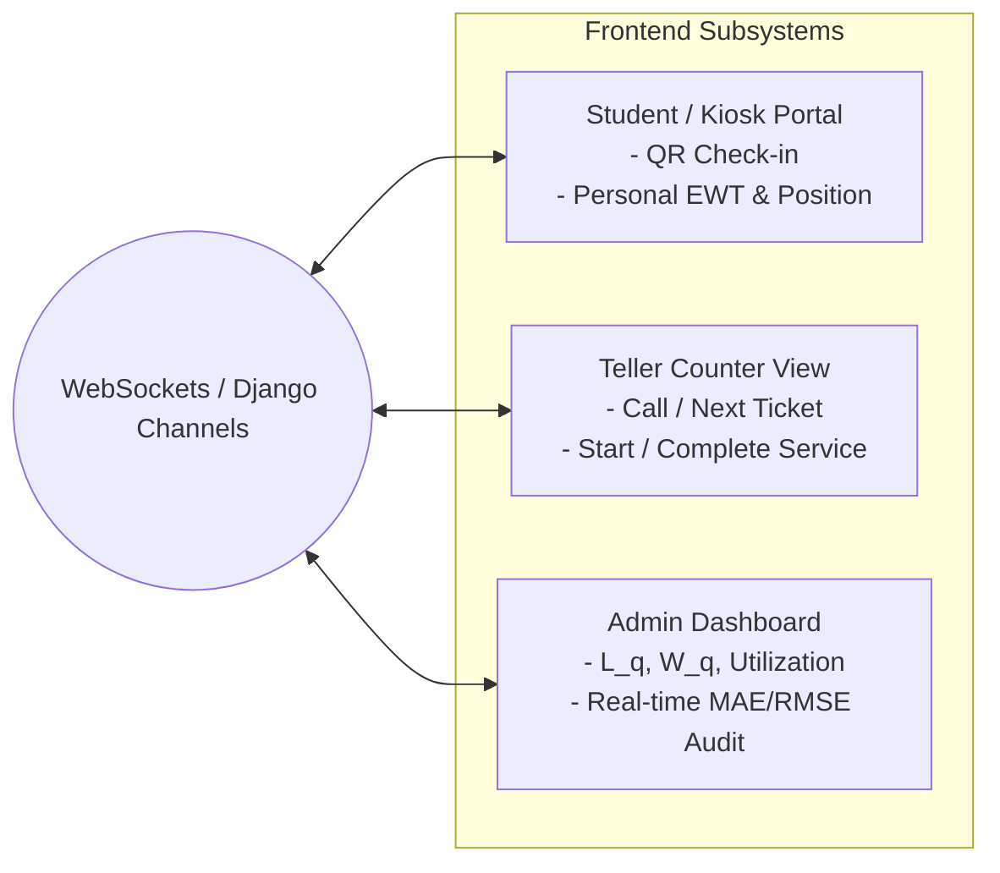

# 07. Subsystem Component Specifications

This document defines the functional, technical, and operational specifications for each of the four core tiers in the Queue Prediction and Management System: **Frontend**, **Backend**, **Database**, and **Machine Learning**.

---

## 1. Frontend Subsystem Specification

The presentation layer delivers role-tailored user interfaces optimized for minimal friction and clear communication of wait-time expectations.

### A. Student & Public Kiosk Portal
- **Digital Ticketing & QR Check-In:**
  - Self-service touch kiosk for on-site walk-ins.
  - Mobile QR check-in enabling students to take a virtual ticket and wait remotely, reducing hall overcrowding.
- **Dynamic Estimated Waiting Time (EWT):**
  - Displays dynamic wait estimates computed by the ML dual-engine.
  - Multi-stage progress bar showing estimated wait across consecutive transaction steps (e.g., Accounts $\rightarrow$ Verification).
- **Turn Notifications:**
  - Visual and auditory alert when ticket is $\le 2$ positions away from the counter.

### B. Staff & Teller Counter Interface
- **Calling Controls:**
  - One-click actions: `Call Next`, `Start Service` ($t_S$), `Complete Service` ($t_D$).
  - Exception handling: `Mark No-Show (Balked/Reneged)`, `Transfer to Department`, `Put on Hold`.
- **Workload Visibility:**
  - Live count of students waiting for that counter’s assigned services.
  - Average transaction time of the current shift.

### C. Administrative Operations & Accuracy Dashboard
- **Macro Performance Metrics:**
  - Real-time queue length ($L_q$).
  - Mean queue wait time ($W_q$).
  - Realized arrival rate ($\lambda$) and service completion rate ($\mu$).
  - Teller utilization rate ($\rho = \frac{\lambda}{c\mu}$).
- **Prediction Accuracy Tracking:**
  - Real-time residual plot comparing Predicted vs. Realized wait times.
  - Rolling Mean Absolute Error (MAE) and Root Mean Squared Error (RMSE).
  - Benchmark comparison widget: ML Engine vs. Baseline AST formula.

---

## 2. Backend Subsystem Specification

The application tier orchestrates business logic, state machines, real-time messaging, and low-latency model inference.

### A. API Architecture (Django REST Framework)
- **Framework:** Python 3.11+, Django 5.x, Django REST Framework.
- **Protocol:** RESTful JSON endpoints over HTTPS.
- **Authentication & RBAC:**
  - JWT (JSON Web Tokens) with role separation: `Admin`, `Teller/Staff`, `Kiosk/Public`.
  - Rate limiting on public check-in endpoints to prevent denial-of-service or token hoarding.

### B. Real-Time Transport (Django Channels & Redis)
- **ASGI Server:** Daphne or Uvicorn.
- **Channel Layer:** Redis 7+ in-memory broker.
- **Message Latency Target:** $< 50$ ms from transaction state change to client screen update.

### C. In-Memory ML Prediction Orchestration
- **Singleton Loader:** Preloads serialized scikit-learn / XGBoost pipelines at boot.
- **Dual-Engine Fail-Safe:** Automatic failover to analytical AST formula if inference fails or inputs are out of bounds.
- **Latency SLA:** $\le 10$ milliseconds end-to-end inference execution time.

### D. Asynchronous Background Task Processing (Celery)
- **Task Broker:** Redis or RabbitMQ.
- **Snapshot Generator:** Runs every 60 seconds to aggregate queue states into `queue_status_snapshots`.
- **Feature Cache Updater:** Updates rolling 7-day AST and Last-to-Enter-Service (LES) metrics every 5 minutes.
- **Automated Model Retraining:** Nightly job retraining models on new completed transaction logs.

---

## 3. Database Subsystem Specification

The data layer provides high-throughput transactional consistency (ACID) and optimized read paths for analytical feature extraction.

### A. Storage Engine & Layout
- **Engine:** PostgreSQL 15+.
- **Primary Schema Separation:**
  1. *Structural Tables:* `branches`, `departments`, `services`, `counters`, `counter_service_mappings`.
  2. *Transactional Tables:* `customers`, `tickets`, `service_transactions`.
  3. *Snapshot & Cache Tables:* `queue_status_snapshots`, `rolling_service_metrics`, `exogenous_contexts`.
  4. *ML Audit Tables:* `model_registry`, `prediction_logs`.

### B. Indexing Strategy
- **Partial Index:** `CREATE INDEX ON service_transactions(service_id) WHERE transaction_status = 'waiting';` for instant line depth retrieval.
- **B-Tree Indices:** On `waiting_start_time`, `created_at`, and `ticket_id` for accelerated window queries.
- **Unique Constraints:** Composite unique key on `(service_id, priority_level)` in `rolling_service_metrics`.

### C. Concurrency & Performance
- Connection pooling via **PgBouncer** (max 200 concurrent connections).
- Statement timeout set to 2.0 seconds to prevent unindexed queries from blocking transactions.

---

## 4. Machine Learning Subsystem Specification

The machine learning tier manages offline feature engineering, model training, temporal validation, and real-time inference.

### A. Problem Formulation
- **Primary Task:** Supervised regression predicting continuous queue waiting time ($W_q$) in seconds.
- **Target Transformation:** $y = \ln(W_q + 1)$ to normalize right-skewed queue wait distributions.
- **Alternative Architecture:** Hierarchical model:
  - Stage 1: Binary classifier detecting short delays ($\le 10$ min) vs. long delays.
  - Stage 2: Regressor estimating continuous delay for the identified class.

### B. Model Families Evaluated
- **Random Forest Regressor:** Robust to outliers, captures complex non-linear queue interactions without heavy feature scaling.
- **Gradient Boosted Trees (XGBoost / LightGBM):** High sample efficiency, fast inference, native handling of categorical features.
- **Deep Neural Networks (MLP / TCN):** Multi-layer perceptrons or temporal convolutional networks for sequence modeling.
- **AutoML Frameworks:** Automated hyperparameter tuning and model architecture search.

### C. Validation & Evaluation Protocol
- **Temporal Train-Test Split:** Enforces strict time-based partitioning (e.g., historical months for training, subsequent weeks for testing) to prevent chronological data leakage.
- **Rolling Window Cross-Validation:** Simulates production deployment across rolling temporal windows.
- **Evaluation Metrics:**
  - Mean Absolute Error (MAE): Direct operational metric (average error in minutes).
  - Root Mean Squared Error (RMSE): Penalizes large under-predictions during severe congestion.
  - Regression Error Characteristic (REC) Curves: Percentage of predictions accurate within an acceptable error tolerance (e.g., $\pm 3$ minutes).

### D. Model Governance & Continuous Retraining
- **Quality Gates:** Newly retrained models must achieve $\text{MAE}_{\text{new}} \le 0.95 \times \text{MAE}_{\text{baseline AST}}$ before promotion to production.
- **Model Registry:** Serialized artifacts stored with full provenance, training data hashes, and evaluation metrics in `model_registry`.
