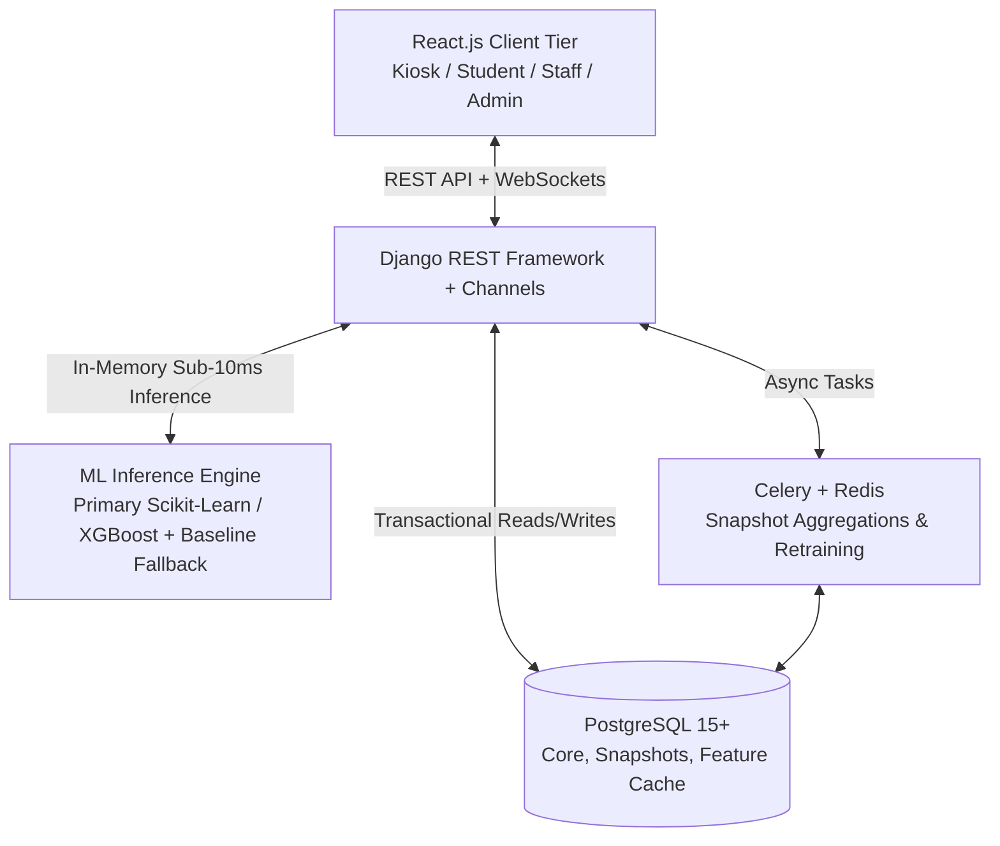

# Queue Waiting-Time Prediction & Management System — Research Repository

Welcome to the research documentation repository for the **ML-Driven Queue Waiting-Time Prediction and Management System**. This collection synthesizes operational queueing theory ($M/M/1$, $M/M/c$), empirical field observation methods, database modeling, full-stack system architecture, machine learning integration, and implementation roadmaps.

---

## 📚 Document Index

| # | Topic | Document | Description |
|---|---|---|---|
| **01** | **Features & Target Variables** | [`01_features_and_target_variables.md`](file:///c:/Users/Anupam%20Baral/Desktop/ML%20queue/research/01_features_and_target_variables.md) | Commonly used queue features, arrival-time availability constraints, target variable definitions ($W_q$, $W_s$), and calculation methodologies. |
| **02** | **Baseline Models & Queueing Theory** | [`02_baseline_models_and_queueing_theory.md`](file:///c:/Users/Anupam%20Baral/Desktop/ML%20queue/research/02_baseline_models_and_queueing_theory.md) | Non-ML benchmarks, empirical rolling averages, Delay-History (LES, HOL), Queue-Length estimators, Average Service Time (AST), and classical queueing models. |
| **03** | **Data Collection Protocol** | [`03_data_collection_protocol_college_queue.md`](file:///c:/Users/Anupam%20Baral/Desktop/ML%20queue/research/03_data_collection_protocol_college_queue.md) | Structured observational field study protocol for a college account section queue lacking historical logs, with Little's Law validation. |
| **04** | **Database Schema & Entity Design** | [`04_database_design_and_entities.md`](file:///c:/Users/Anupam%20Baral/Desktop/ML%20queue/research/04_database_design_and_entities.md) | Relational database schema (PostgreSQL), core entities, minute-by-minute system snapshots, rolling delay cache, model registry, and ER diagram. |
| **05** | **System Architecture** | [`05_system_architecture_react_django_postgres.md`](file:///c:/Users/Anupam%20Baral/Desktop/ML%20queue/research/05_system_architecture_react_django_postgres.md) | High-level topology across React.js, Django REST Framework, PostgreSQL, Django Channels (WebSockets), and Celery/Redis asynchronous workers. |
| **06** | **Django ML Integration Guide** | [`06_django_ml_integration_guide.md`](file:///c:/Users/Anupam%20Baral/Desktop/ML%20queue/research/06_django_ml_integration_guide.md) | Low-latency ($\le 10$ ms) scikit-learn model serving in DRF using singleton in-memory caching, pipeline serialization, input validation, and dual-engine fallback. |
| **07** | **Component Specifications** | [`07_component_specifications.md`](file:///c:/Users/Anupam%20Baral/Desktop/ML%20queue/research/07_component_specifications.md) | Detailed functional and technical requirements for Frontend, Backend, Database, and Machine Learning subsystems. |
| **08** | **Implementation Roadmap & Gantt Schedule** | [`08_implementation_roadmap_and_schedule.md`](file:///c:/Users/Anupam%20Baral/Desktop/ML%20queue/research/08_implementation_roadmap_and_schedule.md) | 8-phase end-to-end CRISP-DM engineering roadmap, inter-phase dependency matrix, 12-week Gantt schedule, and risk mitigation strategies. |

---

## 🏛️ System Overview

All research documents are formatted with math LaTeX notation, system diagrams, and practical implementation snippets.
